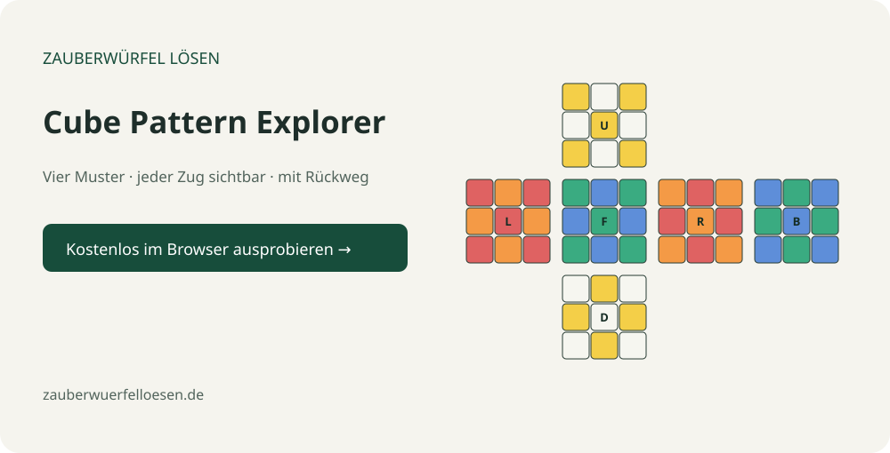

# Cube Pattern Explorer

Explore four classic Rubik’s Cube patterns one move at a time, in German.

**[Open the live explorer →](https://zauberwuerfelloesen.github.io/cube-pattern-explorer/)** · [More cube patterns](https://zauberwuerfelloesen.de/zauberwuerfel-muster/)



## Features
- Checkerboard, six spots, cube in a cube and superflip.
- All six faces shown in a calculated SVG cube net.
- Previous/next move, timeline slider, individual move selection and playback.
- Reverse mode starts at the completed pattern and returns to solved.
- Custom sequences, with validation and a limit of 200 moves.
- Outer face, wide, slice and whole-cube moves; no dependencies or tracking.

This is a stepwise cube-net simulator, not an animated 3D cube. Start from solved with yellow on U, green on F and orange on R. Different physical color schemes change the colors, not the move geometry. Every pattern and custom sequence can be undone with its computed inverse.

## Run and test
Open `index.html` or serve the repository with a static HTTP server. No build step.

```sh
node test.js
```

Tests verify all pattern inverses, the checkerboard geometry, six-spot face rings, all twelve flipped superflip edges, unchanged superflip corners/centers and 54-sticker rendering.

## Code
`cube.js` provides the same immutable cube model used by our [Algorithm Trainer](https://github.com/zauberwuerfelloesen/cube-algorithm-trainer). `app.js` handles pattern data, playback and custom input. SVG illustrations are calculated locally from the sequence, not copied from a reference.

## References
Move sequences: [Rubik bundle pattern list, R. W. D. Nickalls and A. Syropoulos](https://ctan.math.washington.edu/tex-archive/macros/latex/contrib/rubik/rubikpatternsLIST.pdf). Names describe the pattern geometry; our color scheme differs from the reference’s WB scheme.

## Contribute
Issues and focused pull requests are welcome. Include the pattern, move index, browser and reproduction steps.

## License
[MIT](LICENSE). A project by [Zauberwürfel lösen](https://zauberwuerfelloesen.de/).

